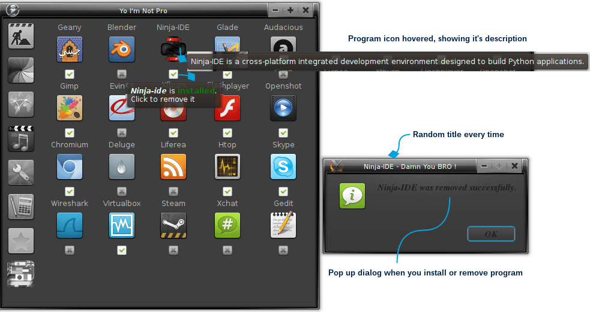

Small application center separated on categories for Arch Linux, Debian and OpenBSD. It has 90 predefined applications.

The program checks whether those program exists and will display appropriate image - X not installed, Mark sign means installed. If the program is not installed by clicking X it will install it, if you click again it will remove it. There are tooltip text, just hover your mouse over the wanted application icon or it's install/remove button to see those texts in action.

I was inspired by Zorin OS and GNOME 3 to create this program.

April 21 2014: Bulgarian translation was added, thankfully to Metodi Kirov.

## Requirements

Arch Linux, Debian or OpenBSD. Derivatives that use pacman or apt get the Arch or Debian package names.

* Arch: `pacman -S python python-gobject python-cairo gtk3`
* Debian: `apt install python3-gi python3-gi-cairo gir1.2-gtk-3.0`
* OpenBSD: `pkg_add py3-gobject3 py3-cairo gtk+3`

Apps with no package on your system are greyed out.

## Usage

It installs packages, so run it as root:

    sudo -E python3 yoimnotpro.py     # Arch, Debian
    doas python3 yoimnotpro.py        # OpenBSD

Tests: `python3 -m unittest`

## 7 Languages are available:

* English
* Bulgarian
* Russian (google translate)
* German (google translate)
* Spanish (google translate)
* French (google translate)
* Hindi (google translate)
